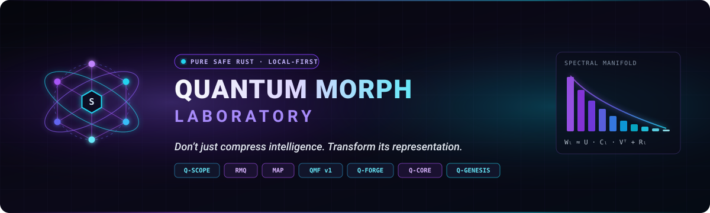
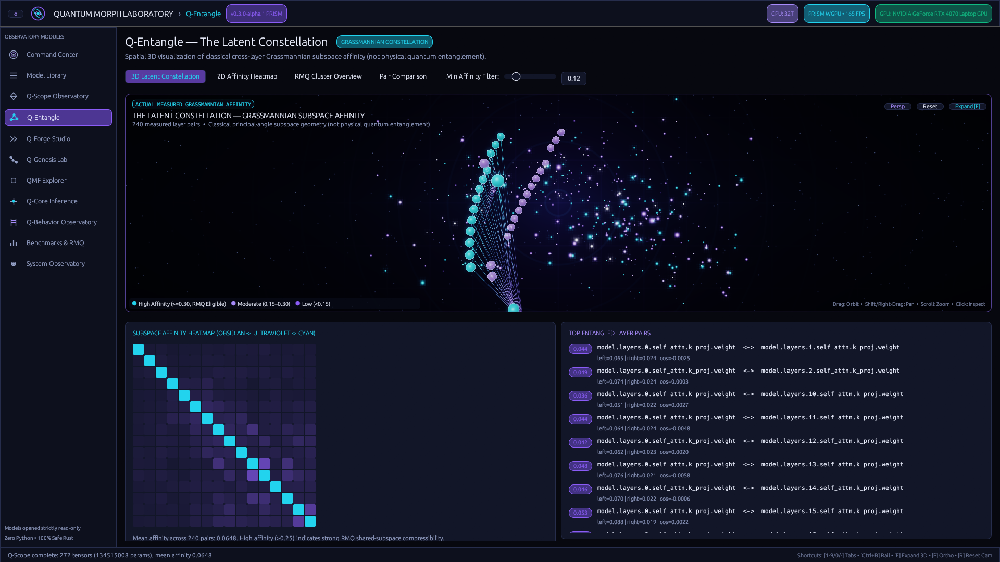
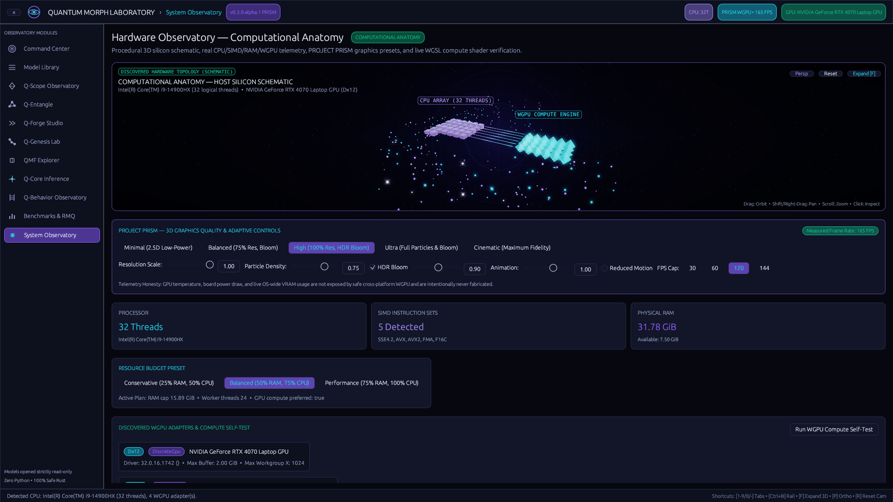
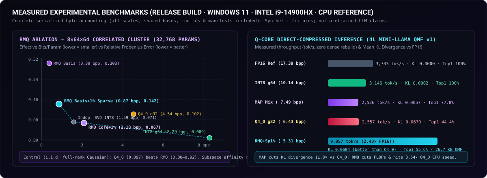

<p align="center">
  
</p>

<p align="center">
  <a href="https://github.com/ShamelesAbyss/Quantum-Morph-Laboratory/releases/latest"></a>
  <a href="https://github.com/ShamelesAbyss/Quantum-Morph-Laboratory/releases/download/v0.5.1/Quantum-Morph-Laboratory-v0.5.1-Windows-x64.exe"></a>
  <a href="https://github.com/ShamelesAbyss/Quantum-Morph-Laboratory/releases/download/v0.5.1/Quantum-Morph-Laboratory-v0.5.1-Linux-x64.tar.gz"></a>
  <a href="https://github.com/ShamelesAbyss/Quantum-Morph-Laboratory/actions/workflows/ci.yml"></a>
  
  <a href="LICENSE"></a>
</p>

<h3 align="center"><em>Don't just compress intelligence. Transform its representation.</em></h3>

<p align="center">
  An experimental, local-first Rust neural model research laboratory featuring <strong>Activation-Aware Blockwise Cholesky GPTQ + Hadamard Sub-3-Bit Compression</strong>, a <strong>Single-Submission Full GPU-Resident WGSL Transformer (<code>GpuFull</code>, 22× speedup)</strong>, multi-shard Llama &amp; Qwen2 streaming, GGUF K-quant ingestion, and the native multi-pass WGPU 3D scientific observatory (<strong>PROJECT PRISM</strong>).
</p>

---

## Download Quantum Morph Laboratory (`v0.5.1` — PROJECT EVENT HORIZON Wave II)

Launch the native desktop scientific observatory directly on your computer — **no Rust toolchain, no Python, no terminal, and no cloud account required**.

<p align="center">
  <a href="https://github.com/ShamelesAbyss/Quantum-Morph-Laboratory/releases/download/v0.5.1/Quantum-Morph-Laboratory-v0.5.1-Windows-x64.exe"></a>
  &nbsp;
  <a href="https://github.com/ShamelesAbyss/Quantum-Morph-Laboratory/releases/download/v0.5.1/Quantum-Morph-Laboratory-v0.5.1-Windows-x64-Portable.zip"></a>
  &nbsp;
  <a href="https://github.com/ShamelesAbyss/Quantum-Morph-Laboratory/releases/download/v0.5.1/Quantum-Morph-Laboratory-v0.5.1-Linux-x64.tar.gz"></a>
  &nbsp;
  <a href="https://github.com/ShamelesAbyss/Quantum-Morph-Laboratory/releases/latest"></a>
  &nbsp;
  <a href="ARCHITECTURE.md"></a>
</p>

| Download Option | Contents | Direct Link |
|---|---|---|
| **Windows Standalone EXE** | Single native Windows desktop application (`qml-desktop`) — double-click to launch | [Download `Quantum-Morph-Laboratory-v0.5.1-Windows-x64.exe`](https://github.com/ShamelesAbyss/Quantum-Morph-Laboratory/releases/download/v0.5.1/Quantum-Morph-Laboratory-v0.5.1-Windows-x64.exe) |
| **Windows Portable ZIP** | Native desktop app + `qml.exe` CLI + full docs + MIT License | [Download `Quantum-Morph-Laboratory-v0.5.1-Windows-x64-Portable.zip`](https://github.com/ShamelesAbyss/Quantum-Morph-Laboratory/releases/download/v0.5.1/Quantum-Morph-Laboratory-v0.5.1-Windows-x64-Portable.zip) |
| **Linux x64 Tarball** | Native desktop app + `qml` CLI + full docs + MIT License | [Download `Quantum-Morph-Laboratory-v0.5.1-Linux-x64.tar.gz`](https://github.com/ShamelesAbyss/Quantum-Morph-Laboratory/releases/download/v0.5.1/Quantum-Morph-Laboratory-v0.5.1-Linux-x64.tar.gz) |
| **Latest Public Release & Checksums** | Full release notes, `SHA256SUMS.txt`, and all release assets | [View Latest Release (`releases/latest`)](https://github.com/ShamelesAbyss/Quantum-Morph-Laboratory/releases/latest) |

---

## PROJECT PRISM — Native WGPU 3D Scientific Observatory

*All screenshots below are genuine, unedited native Windows WGPU GPU captures rendered live by `qml-desktop.exe --release` on an NVIDIA GeForce RTX 4070 Laptop GPU (`157–187 FPS`, custom WGSL shaders, `Rgba16Float` HDR selective bloom, interactive 3D orbit/ortho cameras & ray picking).*

<p align="center">
  
  <br/>
  <em><strong>Command Center — The Computational Singularity (2560×1440 native WGPU, 180 FPS):</strong> Interactive 3D orbital centerpiece with clickable subsystem portals, symmetric host telemetry, and zero-Python safe-Rust architecture.</em>
</p>

<table>
  <tr>
    <td width="50%" align="center">
      
      <br/>
      <em><strong>Q-Scope 3D Neural Anatomy (Real SmolLM2-135M):</strong> 272 measured tensors across 30 layers with 6 live visual modes, 32-bin histogram & SVD spectra.</em>
    </td>
    <td width="50%" align="center">
      
      <br/>
      <em><strong>Q-Entangle Latent Constellation (Real SmolLM2-135M):</strong> 240 measured cross-layer Grassmannian subspace affinity pairs & 2D heatmap.</em>
    </td>
  </tr>
  <tr>
    <td width="50%" align="center">
      
      <br/>
      <em><strong>Q-Genesis Evolutionary Crucible:</strong> 3D objective space (BPP × Matvec Error × FLOPs) with recorded parent-child lineage & Pareto frontier.</em>
    </td>
    <td width="50%" align="center">
      
      <br/>
      <em><strong>Hardware Observatory & PRISM Controls:</strong> 3D CPU/WGPU schematic, 5 graphics presets, live FPS, resource budgets, VRAM Fit Matrix & WGSL compute self-tests.</em>
    </td>
  </tr>
</table>

---

> **Scientific Integrity Notice:** Quantum Morph Laboratory (QML) is active experimental research software (`v0.5.1 — PROJECT EVENT HORIZON Wave II`), not production software. "Quantum-inspired" refers strictly to classical mathematics (tensor networks, spectral decompositions, Walsh–Hadamard incoherence, Grassmannian subspace geometry) and makes **no** claim of physical quantum computation or quantum advantage. QML has been validated end-to-end on synthetic benchmarks (`exp-001`) and **five real openly licensed pretrained language models** across `135M → 3.09B` parameters (`SmolLM2-135M`, `SmolLM2-360M`, `SmolLM2-1.7B`, `Qwen2.5-1.5B`, and 2-shard `Qwen2.5-3B` in `exp-002` through `exp-005`; weights stored locally outside Git). Every byte—including scales, zero-points, biases, codebooks, recovery adapters, shared bases, sparse indices, JSON manifests, and checksums—is counted in reported complete BPP; negative controls and sub-2-bit cliffs are preserved alongside breakthroughs.

---

## Architecture & Representation Pipeline

<p align="center">
  
</p>

### Implemented Subsystems (13 Safe Rust Crates)

| Subsystem | Crate | Implemented Capabilities | Maturity |
|---|---|---|---|
| **Core Math & SHA-256** | `qml-core` | Validated dense matrices, `matmul`/`transpose`/`matvec_transposed`, SplitMix64 PRNG, exact **one-sided Jacobi thin SVD**, HMT randomized SVD, spectral metrics, Grassmannian subspace affinity, pure-Rust FIPS 180-4 **SHA-256** | Implemented & tested |
| **Hardware & WGPU** | `qml-hardware` | CPU/SIMD/RAM telemetry, WGPU discovery, **9 compressed matvec WGSL shaders** + **6 Full GPU-Resident Transformer WGSL shaders (`gpu_full.rs`)** (`RMSNorm`, bit-exact GPU `Hadamard FWHT`, `RoPE + KV-Append`, online-softmax `GQA Attention`, `SwiGLU`, `VecAdd`) | Implemented & GPU-verified |
| **Model Ingestion** | `qml-model` | Bounded read-only single & **multi-shard Safetensors (`SafetensorsSource`)** up to `4 GiB/tensor`, exact safe-Rust codecs (`F64`, `F32`, `F16`, `BF16`, `FP8`, ints), HF `config.json` parser, bounded **GGUF v2/v3 payload decoding including K-quants (`Q2_K`, `Q3_K`, `Q4_K`, `Q5_K`, `Q6_K`)** | Implemented & tested |
| **Q-Scope Observatory** | `qml-scope` | Two-pass streaming Welford statistics (mean, std, skewness, kurtosis, norms, sparsity, 3σ/6σ outliers, crest factor, 32-bin histogram & Shannon entropy, quantization susceptibility proxy), 2D SVD structure, transformer role classification, cross-layer Grassmannian subspace affinity | Implemented & tested |
| **Quant, RMQ, Resonance & GPTQ** | `qml-quant` | Conventional baselines, **RMQ Shared-Basis/Core**, **Sub-3-Bit PROJECT RESONANCE** (FWHT, LS-refitted `INT3`/`INT2`/base-3 `TERNARY`, LUT RVQ, ECHO, `MAP-B`), and **Activation-Aware Blockwise Cholesky GPTQ (`gptq.rs`)** with orthogonal `Q H_b Qᵀ` covariance rotation, `actorder`, adaptive shrinkage damping & AWQ-weighted ECHO | Experimental & benchmarked |
| **QMF Container** | `qml-format` | Experimental **QMF v0** & multi-GB **QMF v1** (`QmfFileReader` out-of-core lazy reader, `write_to_file_atomic` with source-output alias protection, 64 KiB streaming CRC-32 + SHA-256, `Arc` deduplication, RMQ & sub-3-bit operators, on-demand `decode_row`) | Experimental (unstable) |
| **Q-Forge Engine** | `qml-forge` | Memory-bounded single & **multi-shard streaming** (`forge_path_to_file_atomic`, zero duplicate full-file RAM) with **Activation-Calibrated GPTQ**, cooperative `ForgeControl` cancellation, `QMR-300..150`, `RmqAffinityGated`, SHA-256 provenance, and round-trip verification | Experimental & tested |
| **Pure-Rust Tokenizer** | `qml-tokenizer` | Pure safe Rust Hugging Face `tokenizer.json` Byte-Level BPE tokenizer (GPT-2/SmolLM/Llama-3/Qwen2 style) with individual-digit pre-tokenization, special tokens, ChatML formatting, and stateful UTF-8 `StreamingDecoder` | Implemented & tested |
| **Q-Core Runtime** | `qml-runtime` | Native **Llama & Qwen2** Transformer (RMSNorm, RoPE, optional `q/k/v` biases, GQA + **FP64 / INT8 KV-cache**, SwiGLU MLP, `tie_word_embeddings`, calibration Hessian collector) executing directly over QMF v1 on **`Cpu`**, **`GpuHybrid`**, or **Single-Submission `GpuFull`** | Experimental CPU + GPU runtime |
| **Q-Behavior Observatory** | `qml-behavior` | Layer-by-layer hidden activation tracing, cosine/L2 drift, **RSA**, reversible causal ablations (`ScaleResidual`, `AblateAttention`, `AblateMlp`), **`ReferenceSuiteCache`** (zero reference VRAM contention), and **4-category held-out Capability Retention Suite** | Experimental & verified |
| **Q-Genesis Extreme** | `qml-genesis` | Multi-objective NSGA-II evolutionary search with role/depth-stratified sampling, user profiles, **sub-3-bit Hadamard & ECHO layer genes**, and direct **Genome-to-QMF v1 export** | Experimental & tested |
| **Laboratory CLI** | `qml-cli` | 15 commands (`doctor`, `inspect-safetensors`, `inspect-gguf`, `inspect-qmf`, `scope`, `baseline`, `rmq-ablate`, `morph`, `compare`, `resonance-ladder --calibrate`, `infer-demo`, `generate`, `behavior`, `genesis`, `demo-rank1`) with text and `--json` output | Implemented & tested |
| **Native Desktop App** | `qml-desktop` | **PROJECT PRISM** native WGPU 3D scientific observatory (`eframe`/`egui` + `wgpu 24` + 7 custom WGSL shaders + HDR bloom + 3D ray picking) across **11 real-engine views**, **`GpuFull` inference**, `QMR-300..150` Q-Forge presets, and the **Consumer VRAM Fit Matrix (`1.7B–32B`)** | `v0.5.1` |

---

## Real Pretrained Model Validation

### 1. PROJECT EVENT HORIZON Wave II — Activation-Calibrated GPTQ+Hadamard & `GpuFull` Scaling (`360M → 3B`, `exp-005`)

Measured live on Windows 11 x86_64 (Intel Core i9-14900HX, NVIDIA GeForce RTX 4070 Laptop GPU 8 GB VRAM) using **single-submission `QCoreBackend::GpuFull`** and **196 disjoint multi-domain calibration tokens** (`64×64` block-diagonal Hessians, **zero extra bytes** stored in QMF v1; see [`experiments/exp-005-event-horizon-wave2-gptq-scaling.toml`](experiments/exp-005-event-horizon-wave2-gptq-scaling.toml)):

- **Single-Submission `GpuFull` vs `GpuHybrid` Speedup (`SmolLM2-360M` `Q4_0`, identical word-for-word output):** `1.84 tok/s` (`36,923 ms`) → **`40.70 tok/s` (`1,671 ms` — `22.1×` real end-to-end speedup)**, reaching **`63.3 tok/s`** at 2-bit on `SmolLM2-360M` and **`18.6–31.5 tok/s`** on `1.5B–3B` models!

#### A. Progressive Scaling Law Across 4 Real Pretrained Models (`360M → 1.5B → 1.7B → 2-Shard 3B`)

| Model (Architecture, BF16 Size) | Profile | Complete BPP | VRAM MiB | `GpuFull` Tok/s | PPLx vs BF16 | Mean KL | Held-out Top-1 | Ret% | Status |
|---|---|---:|---:|---:|---:|---:|---:|---:|---|
| **Stage C: `Qwen2.5-3B-Instruct`** *(2-shard, 6.17 GB, Qwen2 biases)* | `INT4_Q4_0_GPTQ` | 4.502 | 1,657.2 | 11.2 | **1.01×** | **0.147** | **84.0%** | **91.4%** | **OK** |
| **Stage C: `Qwen2.5-3B-Instruct`** *(2-shard, 6.17 GB, Qwen2 biases)* | `INT3_HADAMARD_GPTQ` | **3.253** | **1,197.4** *(5.15×)* | 8.7 | **1.07×** | **0.237** | **78.3%** | **85.8%** | **OK** |
| **Stage C: `Qwen2.5-3B-Instruct`** *(2-shard, 6.17 GB, Qwen2 biases)* | **`INT2_HADAMARD_GPTQ`** | **2.253** | **829.6** *(7.43×)* | **18.6** | **2.76×** | **1.606** | **55.4%** | **45.8%** | **OK** |
| **Stage B-2: `Qwen2.5-1.5B-Instruct`** *(3.09 GB, Qwen2 biases)* | `INT4_Q4_0_GPTQ` | 4.503 | 829.7 | 23.3 | 1.28× | 0.161 | **84.0%** | 81.0% | OK |
| **Stage B-2: `Qwen2.5-1.5B-Instruct`** *(3.09 GB, Qwen2 biases)* | **`INT3_HADAMARD_GPTQ`** | **3.253** | **599.7** *(5.15×)* | **22.8** | **1.03×** *(+3%!)* | **0.295** | **77.7%** | **87.2%** | **OK** |
| **Stage B-2: `Qwen2.5-1.5B-Instruct`** *(3.09 GB, Qwen2 biases)* | **`INT2_HADAMARD_GPTQ`** | **2.253** | **415.7** *(7.43×)* | **31.5** | **4.12×** | **1.993** | **41.7%** | **33.0%** | **OK** |
| **Stage B-2: `Qwen2.5-1.5B-Instruct`** *(3.09 GB, Qwen2 biases)* | `TERNARY_HADAMARD_GPTQ` | 1.731 | 319.6 | 27.6 | 590.16× | 7.239 | 7.4% | 3.8% | CLIFF |
| **Stage B-1: `SmolLM2-1.7B-Instruct`** *(3.42 GB, Llama)* | `INT4_Q4_0_GPTQ` | 4.502 | 918.9 | 19.7 | 1.68× | 0.605 | **83.5%** | 71.6% | OK |
| **Stage B-1: `SmolLM2-1.7B-Instruct`** *(3.42 GB, Llama)* | `INT3_HADAMARD_GPTQ` | 3.252 | 663.9 | 14.1 | 1.71× | 0.698 | **83.0%** | 70.7% | OK |
| **Stage B-1: `SmolLM2-1.7B-Instruct`** *(3.42 GB, Llama)* | `QMR-300_GPTQ` | **3.000** | **612.5** | 16.3 | 2.27× | 1.046 | **71.6%** | 57.9% | OK |
| **Stage B-1: `SmolLM2-1.7B-Instruct`** *(3.42 GB, Llama)* | **`QMR-250_GPTQ`** | **2.500** | **510.5** *(6.70×)* | **22.6** | **2.79×** | **1.327** | **58.0%** | **46.9%** | **OK** |
| **Stage B-1: `SmolLM2-1.7B-Instruct`** *(3.42 GB, Llama)* | `INT2_HADAMARD_GPTQ` | 2.252 | 459.9 | 30.7 | 8.09× | 2.460 | 39.2% | 25.8% | CLIFF |
| **Stage B-1: `SmolLM2-1.7B-Instruct`** *(3.42 GB, Llama)* | `TERNARY_HADAMARD_GPTQ` | 1.728 | 353.1 | 25.7 | 116.14× | 5.110 | 10.2% | 5.5% | CLIFF |

#### B. Direct Matched-Byte Ablation: `v0.4.0` Weight-Only vs `v0.5.1` Activation-Calibrated GPTQ (`SmolLM2-360M`, Zero Extra Bytes)

| Profile | Exact BPP | VRAM MiB | `v0.4.0` Weight-Only PPLx | **`v0.5.1` GPTQ PPLx** | `v0.4.0` KL | **`v0.5.1` KL** | **`v0.5.1` Top-1** | **`GpuFull` Tok/s** |
|---|---:|---:|---:|---:|---:|---:|---:|---:|
| `INT3_HADAMARD` | 3.270 | 141.4 | 5.63× | **1.64×** *(3.4× lower)* | 1.910 | **0.624** *(−67.3%)* | **68.2%** *(+26.7 pp)* | **41.8** |
| `QMR-300 (MAP-B)` | 3.000 | 129.7 | 13.35× | **2.49×** *(5.4× lower)* | 2.803 | **1.072** *(−61.8%)* | **58.5%** *(+26.7 pp)* | **44.8** |
| **`QMR-275 (MAP-B)`** | **2.750** | **119.0** | *(CLIFF)* | **3.52× (OK!)** | — | **1.457** | **44.3%** | **50.7** |
| `QMR-250 (MAP-B)` | 2.500 | 108.2 | 393.75× | **5.45×** *(72.2× lower)* | 6.566 | **1.981** *(−69.8%)* | **36.9%** *(7.2× higher)* | **54.5** |
| `INT2_HADAMARD` | 2.270 | 98.3 | 2,653.66× *(555,653× plain)* | **13.53×** *(196× lower)* | 8.242 | **2.811** *(−65.9%)* | **29.5%** | **63.3** |
| `TERNARY_HADAMARD` | 1.738 | 75.3 | 5,797.78× | **161.98×** *(35.8× lower)* | 9.208 | **5.397** *(−41.4%)* | 9.1% | 46.9 |

- **Honest Boundary Preserved (`1.73 bpp` Ternary):** While Activation-Calibrated GPTQ+Hadamard broke `QMR-275` (`360M`), `QMR-250` (`1.7B`), and `2.25 bpp INT2` (`1.5B` & `3B`, down to `PPLx = 2.76×` and `55.4%` Top-1 in `829.6 MiB` VRAM!), `1.73 bpp` ternary PTQ still cliffs (`PPLx 116–590×`) at `<= 1.7B` — motivating GPU 2-stage RVQ/AQLM lookup-table kernels and `7B–32B` scaling in Wave III.

### 2. Earlier Validated Research Archive (`exp-001` through `exp-004`)

- **Matched-Byte Hadamard Incoherence Control & Layer-31 Study ([`exp-004`](experiments/exp-004-event-horizon-sub3bit.toml)):** At identical `2.27–2.285 bpp` (zero extra bytes), Randomized FWHT cut plain 2-bit Mean KL by **`−37.9%`** (`135M`, `137.5×` lower PPLx) and **`−39.5%`** (`360M`, `209.4×` lower PPLx). Promoting `SmolLM2-360M` Layer 31 alone to `INT8_SYM` (`+0.102 bpp`) cut L31 `Rel L2` by `−24.0%` (`0.6002 → 0.4560`) but slightly raised KL (`1.284 → 1.499`), proving the cliff was upstream-amplified (subsequently solved across all layers by Wave II GPTQ!).
- **Persistent GPU Hybrid Baselines & Nuanced Controls ([`exp-003`](experiments/exp-003-smollm2-360m-gpu.toml), [`exp-002`](experiments/exp-002-smollm2-135m.toml), [`exp-001`](experiments/exp-001-rmq-map-qcore-baseline.toml)):** Reconciled verbatim: `SmolLM2-360M` `BF16` (`12.10 tok/s`), `INT8_SYM` (`20.97 tok/s`, `95.5%` Top-1), `Q4_0` (`11.65 tok/s`, `77.3%` Top-1), weight-only `MAP 4.516 bpp` (`11.92 tok/s`, `5.30×` GPU speedup, `68.2%` Top-1 preserved nuanced control); `SmolLM2-135M` quant-only MAP (`−16.4%` KL vs `Q4_0`) + unrestricted SVD-8 negative control; and synthetic `exp-001` outlier-peeled RMQ (`−49.2%` error) vs uncorrelated Gaussian control.

<p align="center">
  
</p>

---

## Building from Source (Optional)

Prebuilt executables are available on the [Releases page](https://github.com/ShamelesAbyss/Quantum-Morph-Laboratory/releases/latest). To build from source, only a stable Rust toolchain (`rustc` / `cargo`) is required (zero Python):

```sh
# Format, strict Clippy lint, full test suite across 13 crates, and release build
cargo fmt --all -- --check
cargo clippy --workspace --all-targets -- -D warnings
cargo test --workspace
cargo build --workspace --release

# Launch the native PROJECT PRISM WGPU 3D desktop observatory (with GpuFull inference)
cargo run --release -p qml-desktop

# Transform single OR multi-shard Safetensors -> QMF v1 atomically (supports Llama & Qwen2)
cargo run --release -p qml-cli -- morph ./model.safetensors.index.json --method int3 --output ./out-int3.qmf

# Run the Activation-Calibrated Sub-3-Bit GPTQ+Hadamard Ladder on single-submission GpuFull
cargo run --release -p qml-cli -- resonance-ladder --model ./model.safetensors.index.json --config ./config.json --tokenizer ./tokenizer.json --backend gpu-full --calibrate --no-echo --profiles "int4,int3,qmr-300,qmr-250,int2"

# Run single-submission Full GPU-Resident compressed inference
cargo run --release -p qml-cli -- generate ./out-int3.qmf --config ./config.json --tokenizer ./tokenizer.json --backend gpu-full --chat --prompt "Explain SVD."
```

See [BUILD.md](BUILD.md) for `cargo-deny` policy checks and CI workflow details.

---

## Research Foundation & Continuity

- **Prior-Art Literature Review (17 topics):** [`research/prior-art-index.md`](research/prior-art-index.md) and [`research/prior-art-synthesis.md`](research/prior-art-synthesis.md)
- **Sub-3-Bit Mathematical Synthesis:** [`research/sub-3-bit-resonance-synthesis.md`](research/sub-3-bit-resonance-synthesis.md)
- **Novelty Ledger:** [`research/novelty-ledger.md`](research/novelty-ledger.md) (explicitly distinguishes established literature, falsifiable hypotheses, and QML experimental findings)
- **Container Specifications:** [`research/qmf-experimental-v0.md`](research/qmf-experimental-v0.md) and [`research/qmf-experimental-v1.md`](research/qmf-experimental-v1.md)
- **Architecture & Decisions:** [`ARCHITECTURE.md`](ARCHITECTURE.md), [`ROADMAP.md`](ROADMAP.md), [`docs/decisions/0001-bounded-safetensors-inspection.md`](docs/decisions/0001-bounded-safetensors-inspection.md)
- **Cross-Agent Handoff:** [`AGENTS.md`](AGENTS.md), [`HANDOFF.md`](HANDOFF.md), [`MASTER_DEVELOPMENT_DIRECTIVE.md`](MASTER_DEVELOPMENT_DIRECTIVE.md)

## License

Quantum Morph Laboratory is licensed under the **[MIT License](LICENSE)** (Copyright © 2026 ShamelesAbyss). Third-party Rust crate dependency licenses and advisories are continuously verified by `cargo-deny` in CI ([`deny.toml`](deny.toml)). Prebuilt Windows and Linux release binaries with SHA-256 checksums are published on the [GitHub Releases](https://github.com/ShamelesAbyss/Quantum-Morph-Laboratory/releases/latest) page (see [`RELEASE_NOTES.md`](RELEASE_NOTES.md)).

---

### In Loving Memory of Ashlan Haley Rapponotti

*June 21, 2003 – November 13, 2026*

For the beautiful woman who listened to my passions, believed in me, and made my world a happier place simply by being part of it.

Every creation, every discovery, and every milestone reached carries a piece of my heart dedicated to you.

**Forever loved. Forever missed. Forever remembered.** 💜
