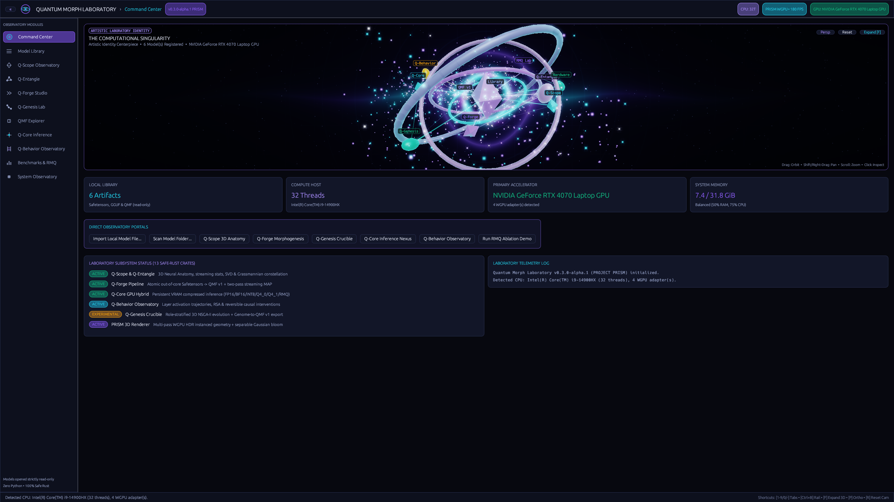
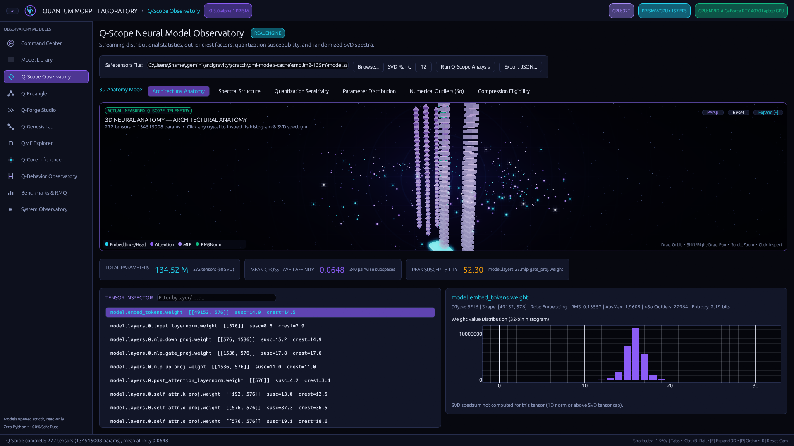
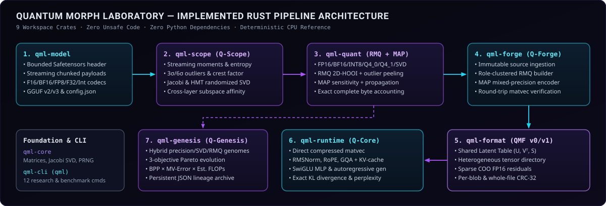

<p align="center">
  
</p>

<p align="center">
  <a href="https://github.com/ShamelesAbyss/Quantum-Morph-Laboratory/releases/latest"></a>
  <a href="https://github.com/ShamelesAbyss/Quantum-Morph-Laboratory/releases/download/v0.4.0/Quantum-Morph-Laboratory-v0.4.0-Windows-x64.exe"></a>
  <a href="https://github.com/ShamelesAbyss/Quantum-Morph-Laboratory/releases/download/v0.4.0/Quantum-Morph-Laboratory-v0.4.0-Linux-x64.tar.gz"></a>
  <a href="https://github.com/ShamelesAbyss/Quantum-Morph-Laboratory/actions/workflows/ci.yml"></a>
  
  <a href="LICENSE"></a>
</p>

<h3 align="center"><em>Don't just compress intelligence. Transform its representation.</em></h3>

<p align="center">
  An experimental, local-first Rust neural model research laboratory featuring a complete-artifact <strong>Sub-3-Bit Compression Research Engine (PROJECT RESONANCE &amp; EVENT HORIZON Wave I)</strong>, <strong>9 persistent GPU-resident WGSL compressed compute kernels</strong>, a native multi-pass WGPU 3D scientific observatory (<strong>PROJECT PRISM</strong>), mechanistic activation observability, shared-subspace weight representations, behavior-aware adaptive precision allocation, and multi-objective evolutionary representation discovery.
</p>

---

## Download Quantum Morph Laboratory (`v0.4.0` — PROJECT RESONANCE & EVENT HORIZON Wave I)

Launch the native desktop scientific observatory directly on your computer — **no Rust toolchain, no Python, no terminal, and no cloud account required**.

<p align="center">
  <a href="https://github.com/ShamelesAbyss/Quantum-Morph-Laboratory/releases/download/v0.4.0/Quantum-Morph-Laboratory-v0.4.0-Windows-x64.exe"></a>
  &nbsp;
  <a href="https://github.com/ShamelesAbyss/Quantum-Morph-Laboratory/releases/download/v0.4.0/Quantum-Morph-Laboratory-v0.4.0-Windows-x64-Portable.zip"></a>
  &nbsp;
  <a href="https://github.com/ShamelesAbyss/Quantum-Morph-Laboratory/releases/download/v0.4.0/Quantum-Morph-Laboratory-v0.4.0-Linux-x64.tar.gz"></a>
  &nbsp;
  <a href="https://github.com/ShamelesAbyss/Quantum-Morph-Laboratory/releases/latest"></a>
  &nbsp;
  <a href="ARCHITECTURE.md"></a>
</p>

| Download Option | Contents | Direct Link |
|---|---|---|
| **Windows Standalone EXE** | Single native Windows desktop application (`qml-desktop`) — double-click to launch | [Download `Quantum-Morph-Laboratory-v0.4.0-Windows-x64.exe`](https://github.com/ShamelesAbyss/Quantum-Morph-Laboratory/releases/download/v0.4.0/Quantum-Morph-Laboratory-v0.4.0-Windows-x64.exe) |
| **Windows Portable ZIP** | Native desktop app + `qml.exe` CLI + full docs + MIT License | [Download `Quantum-Morph-Laboratory-v0.4.0-Windows-x64-Portable.zip`](https://github.com/ShamelesAbyss/Quantum-Morph-Laboratory/releases/download/v0.4.0/Quantum-Morph-Laboratory-v0.4.0-Windows-x64-Portable.zip) |
| **Linux x64 Tarball** | Native desktop app + `qml` CLI + full docs + MIT License | [Download `Quantum-Morph-Laboratory-v0.4.0-Linux-x64.tar.gz`](https://github.com/ShamelesAbyss/Quantum-Morph-Laboratory/releases/download/v0.4.0/Quantum-Morph-Laboratory-v0.4.0-Linux-x64.tar.gz) |
| **Latest Public Release & Checksums** | Full release notes, `SHA256SUMS.txt`, and all release assets | [View Latest Release (`releases/latest`)](https://github.com/ShamelesAbyss/Quantum-Morph-Laboratory/releases/latest) |

---

## PROJECT PRISM — Native WGPU 3D Scientific Observatory

*All screenshots below are genuine, unedited native Windows WGPU GPU captures rendered live by `qml-desktop.exe --release` on an NVIDIA GeForce RTX 4070 Laptop GPU (`157–187 FPS`, custom WGSL shaders, `Rgba16Float` HDR selective bloom, interactive 3D orbit/ortho cameras & ray picking).*

<p align="center">
  
  <br/>
  <em><strong>Command Center — The Computational Singularity (2560×1440 native WGPU, 180 FPS):</strong> Interactive 3D orbital centerpiece with clickable subsystem portals, symmetric host telemetry, and zero-Python safe-Rust architecture.</em>
</p>

<table>
  <tr>
    <td width="50%" align="center">
      
      <br/>
      <em><strong>Q-Scope 3D Neural Anatomy (Real SmolLM2-135M):</strong> 272 measured tensors across 30 layers with 6 live visual modes, 32-bin histogram & SVD spectra.</em>
    </td>
    <td width="50%" align="center">
      
      <br/>
      <em><strong>Q-Entangle Latent Constellation (Real SmolLM2-135M):</strong> 240 measured cross-layer Grassmannian subspace affinity pairs & 2D heatmap.</em>
    </td>
  </tr>
  <tr>
    <td width="50%" align="center">
      
      <br/>
      <em><strong>Q-Genesis Evolutionary Crucible:</strong> 3D objective space (BPP × Matvec Error × FLOPs) with recorded parent-child lineage & Pareto frontier.</em>
    </td>
    <td width="50%" align="center">
      
      <br/>
      <em><strong>Hardware Observatory & PRISM Controls:</strong> 3D CPU/WGPU schematic, 5 graphics presets, live FPS, resource budgets, VRAM Fit Matrix & WGSL compute self-tests.</em>
    </td>
  </tr>
</table>

---

> **Scientific Integrity Notice:** Quantum Morph Laboratory (QML) is active experimental research software (`v0.4.0 — PROJECT RESONANCE & EVENT HORIZON Wave I`), not production software. "Quantum-inspired" refers strictly to classical mathematics (tensor networks, spectral decompositions, Walsh–Hadamard incoherence, Grassmannian subspace geometry) and makes **no** claim of physical quantum computation or quantum advantage. QML has been validated end-to-end on synthetic benchmarks (`exp-001`) and real openly licensed pretrained language models (`HuggingFaceTB/SmolLM2-135M-Instruct` and `HuggingFaceTB/SmolLM2-360M-Instruct` in `exp-002`, `exp-003`, and `exp-004`; weights stored locally outside Git). Every byte—including scales, zero-points, codebooks, recovery adapters, shared bases, sparse indices, JSON manifests, and checksums—is counted in reported complete BPP; negative controls and catastrophic compression cliffs are preserved alongside positive results; and every visualization explicitly distinguishes measured data from theoretical hardware targets or schematic previews.

---

## Architecture & Representation Pipeline

<p align="center">
  
</p>

### Implemented Subsystems (13 Safe Rust Crates)

| Subsystem | Crate | Implemented Capabilities | Maturity |
|---|---|---|---|
| **Core Math & SHA-256** | `qml-core` | Validated dense matrices, `matmul`/`transpose`/`matvec_transposed`, SplitMix64 PRNG, exact **one-sided Jacobi thin SVD**, HMT randomized SVD, spectral metrics, Grassmannian subspace affinity, pure-Rust FIPS 180-4 **SHA-256** | Implemented & tested |
| **Hardware & WGPU** | `qml-hardware` | Cross-platform CPU/SIMD/RAM telemetry, WGPU GPU adapter discovery, enforced resource presets, **9 persistent VRAM WGSL compute kernels** (`FP32`, `FP16`, `BF16`, `INT8_SYM`, `Q4_0`, `Q4_1`, **`INT3_ASYM`**, **`INT2_ASYM`**, **`TERNARY`**) with Walsh–Hadamard pre-rotation & reusable scratch buffers | Implemented & GPU-verified |
| **Model Ingestion** | `qml-model` | Bounded read-only Safetensors header inspection (16 MiB cap), **constant-memory streaming** payload reader (`PayloadBudget` up to 16 GiB), exact safe-Rust codecs (`F64`, `F32`, `F16`, `BF16`, `F8_E4M3`, `F8_E5M2`, ints, bool), sharded `index.json` & HF `config.json` parsers, bounded **GGUF v2/v3 payload decoding** (`F32`, `F16`, `BF16`, `Q8_0`, `Q4_0`, `Q4_1`) | Implemented & tested |
| **Q-Scope Observatory** | `qml-scope` | Two-pass streaming Welford statistics (mean, std, skewness, kurtosis, norms, sparsity, 3σ/6σ outliers, crest factor, 32-bin histogram & Shannon entropy, quantization susceptibility proxy), 2D SVD structure, transformer role classification, cross-layer Grassmannian subspace affinity | Implemented & tested |
| **Baselines, RMQ, MAP & Resonance** | `qml-quant` | Conventional baselines (`FP16`, `BF16`, `INT8`, `Q4_0`, `Q4_1`, `SVD`, `SparseResidual`); **RMQ Shared-Basis/Core**; **Sub-3-Bit PROJECT RESONANCE** (Randomized FWHT incoherence, LS-refitted `INT3`/`INT2`, base-3 packed `TERNARY`, 1/2-stage LUT RVQ, **PROJECT ECHO** INT8 low-rank + sparse recovery, variance-additive **MAP-B** `QMR-300..150`, Consumer VRAM Fit estimator) | Experimental & benchmarked |
| **QMF Container** | `qml-format` | Experimental **QMF v0** & multi-GB **QMF v1** (`QmfFileReader` out-of-core lazy reader, `write_to_file_atomic` with source-output alias protection, 64 KiB streaming CRC-32 + SHA-256, `QmfLatentCache` `Arc` deduplication, `RmqSharedCore`, sub-3-bit `Int3AsymGroup`/`Int2AsymGroup`/`TernaryPacked`/`VectorQuant`/`EchoCorrected`, on-demand `decode_row`) | Experimental (unstable) |
| **Q-Forge Engine** | `qml-forge` | Memory-bounded streaming Safetensors → QMF v1 pipeline with cooperative `ForgeControl` cancellation, live progress callbacks, `RmqAffinityGated`, **Sub-3-Bit `QMR-300..150` / `Int3Hadamard` / `Int2Hadamard` / `TernaryHadamard` / `VectorQuant` / `Int2Echo` / `BehaviorProtected`**, atomic publication, SHA-256 provenance, and round-trip verification | Experimental & tested |
| **Pure-Rust Tokenizer** | `qml-tokenizer` | Pure safe Rust Hugging Face `tokenizer.json` Byte-Level BPE tokenizer (GPT-2/SmolLM/Llama-3/Qwen2 style) with individual-digit pre-tokenization, special tokens, ChatML formatting, and stateful UTF-8 `StreamingDecoder` | Implemented & tested |
| **Q-Core Runtime** | `qml-runtime` | Native Llama-style Transformer (RMSNorm, RoPE, GQA + KV-cache, SwiGLU MLP, `tie_word_embeddings`, on-demand `decode_row`, `Arc` shared-latent cache) executing **directly over QMF v1 compressed operators (including sub-3-bit + ECHO)** on **CPU (Rayon)** or **Persistent GPU Hybrid**, plus activation tracing & reversible `LayerIntervention` hooks | Experimental CPU + GPU runtime |
| **Q-Behavior Observatory** | `qml-behavior` | Layer-by-layer hidden activation tracing (`compare_model_behavior`), cosine similarity, relative L2 drift, **Representational Similarity Analysis (RSA)**, reversible causal ablations (`ScaleResidual`, `AblateAttention`, `AblateMlp`), and **4-category held-out Capability Retention Suite** (`Reasoning`, `Coding`, `Knowledge`, `InstructionFollowing`) | Experimental & verified |
| **Q-Genesis Extreme** | `qml-genesis` | Multi-objective NSGA-II evolutionary search with role/depth-stratified sampling, user profiles (`Balanced`, `Smallest`, `BestQuality`, `Fastest`), **sub-3-bit Hadamard & ECHO layer genes**, and direct **Genome-to-QMF v1 export** | Experimental & tested |
| **Laboratory CLI** | `qml-cli` | 15 commands (`doctor`, `inspect-safetensors`, `inspect-gguf`, `inspect-qmf`, `scope`, `baseline`, `rmq-ablate`, `morph`, `compare`, `resonance-ladder`, `infer-demo`, `generate`, `behavior`, `genesis`, `demo-rank1`) with text and `--json` output | Implemented & tested |
| **Native Desktop App** | `qml-desktop` | **PROJECT PRISM** native WGPU 3D scientific observatory (`eframe`/`egui` + `wgpu 24` + 7 custom WGSL shaders + HDR bloom + 3D ray picking) across **11 real-engine views**, now with `QMR-300..150` Q-Forge presets and the **PROJECT RESONANCE Consumer VRAM Fit Matrix (`1.7B–32B`)** | `v0.4.0` |

---

## Real Pretrained Model Validation

### 1. PROJECT RESONANCE & EVENT HORIZON Wave I — Complete-Artifact Sub-3-Bit Ladder (`exp-004`)

Measured directly on Windows 11 x86_64 (Intel Core i9-14900HX, NVIDIA GeForce RTX 4070 Laptop GPU, 9 persistent WGSL GPU kernels) over a **held-out 4-category Capability Retention Suite** (`Reasoning`, `Coding`, `Knowledge`, `InstructionFollowing`; see [`experiments/exp-004-event-horizon-sub3bit.toml`](experiments/exp-004-event-horizon-sub3bit.toml)). **Every byte** of the complete on-disk QMF v1 artifact is counted in Complete BPP.

#### A. `HuggingFaceTB/SmolLM2-360M-Instruct` (`361.8M` params, `embed_tokens` = 13.0% of model)

| QMF v1 Variant | Complete BPP | VRAM Weights | Mean KL vs BF16 | PPL Inflation | Top-1 Match | Logit Cos | Notes |
|---|---:|---:|---:|---:|---:|---:|---|
| `INT3_HADAMARD (LS-Refit)` | **3.270** | **140.7 MiB** *(4.9× vs BF16)* | **1.910** | **5.63×** | **41.5%** | **0.824** | Coherent English (`+78%` relative Top-1 jump over 135M) |
| **`QMR-300 (MAP-B)`** | **3.000** | **129.1 MiB** | **2.803** | **13.35×** | **31.8%** | **0.769** | Exact `3.000` complete BPP (`+55%` relative Top-1 over 135M) |
| `QMR-250 (MAP-B)` | **2.500** | **107.5 MiB** | 6.566 | 393.75× | 5.1% | 0.511 | `CLIFF` on 360M, yet **`6.0×` lower PPLx** than 135M |
| `INT2_PLAIN` *(Matched Control)* | 2.270 | 97.6 MiB | 13.616 | 555,652.90× | 0.0% | 0.205 | No Hadamard rotation (severe collapse) |
| **`INT2_HADAMARD` *(Zero Extra Bytes)*** | **2.270** | **97.6 MiB** | **8.242 *(−39.5%)*** | **2,653.66× *(209.4× lower)*** | — | **0.436** | Replicated matched-byte Hadamard gain at identical bytes |
| `TERNARY_HADAMARD` *(5 trits/B)* | **1.738** | **74.7 MiB** | 9.208 | 5,797.78× | — | 0.443 | `16.2×` lower PPLx than 135M (`94,138 -> 5,798`) |

#### B. `HuggingFaceTB/SmolLM2-135M-Instruct` (`134.5M` params, `embed_tokens` = 21.0% of model)

| QMF v1 Variant | Complete BPP | VRAM Weights | Mean KL vs BF16 | PPL Inflation | Top-1 Match | Retention | Status |
|---|---:|---:|---:|---:|---:|---:|---|
| `INT4_Q4_0` *(Baseline)* | 4.511 | 72.1 MiB | 0.466 | 1.45× | 65.3% | 67.1% | Coherent English |
| `INT3_HADAMARD (LS-Refit)` | **3.285** | **52.5 MiB** | **2.666** | **10.09×** | **23.3%** | 16.6% | Coherent English; **exact CPU/GPU parity verified** |
| **`QMR-300 (MAP-B)`** | **3.000** | **47.9 MiB** | **3.278** | **17.27×** | **20.5%** | 13.1% | Variance-additive MAP-B cut PPLx `6.16×` (`106.3 -> 17.3`) |
| `QMR-275 (MAP-B)` | 2.750 | 43.9 MiB | 5.204 | 115.07× | 9.1% | 5.0% | `CLIFF` boundary on tiny 135M model |
| `QMR-250 / 225 / 200 / 175` | 2.50 → 1.75 | 39.9 → 26.9 MiB | 8.26 → 12.12 | 2,375× → 85,777× | 1.7% → 0.6% | — | `CLIFF` (honestly recorded weight-only PTQ floor on 135M) |
| `INT2_PLAIN` *(Matched Control)* | 2.285 | 36.4 MiB | 14.025 | 520,461.57× | 0.0% | — | No Hadamard rotation |
| **`INT2_HADAMARD` *(Zero Extra Bytes)*** | **2.285** | **36.4 MiB** | **8.714 *(−37.9%)*** | **3,784.01× *(137.5× lower)*** | **2.8%** | — | Exact matched-byte control (**zero extra bytes**) |
| `TERNARY_HADAMARD` *(5 trits/B)* | 1.758 | 28.0 MiB | 12.045 | 94,137.89× | 0.6% | — | `5.5×` lower PPLx than `2.285 bpp` `INT2_PLAIN` at `−0.53 bpp` |

- **Mechanistic Layer-31 Selective Precision Protection (`SmolLM2-360M`, `exp-004`, nuanced negative control):** Promoting the sharp Layer-31 cliff identified in `exp-003` from `Q4_0` to `INT8_SYM` (`--method q4-protect --protect-layers 31`, `+0.102 bpp` -> `4.608 bpp`) reduced Layer-31 `Rel L2` drift by **−24.0%** (`0.6002 -> 0.4560`) and raised final cosine (`0.9064 -> 0.9114`), yet `L31 RSA` dropped (`0.5697 -> 0.4549`) and output `Mean KL` rose slightly (`1.2837 -> 1.4990`). This falsifies a naive single-layer fix and proves the Layer-31 spike is predominantly **upstream-amplified** (`L00–L30` residual drift + tied `embed_tokens`/`lm_head` quantization), directly motivating activation-aware Hessian/GPTQ compensation in Wave II.

### 2. `HuggingFaceTB/SmolLM2-360M-Instruct` — Persistent GPU Hybrid Inference & Q-Behavior (`exp-003`)

Measured on Windows 11 x86_64 (Intel Core i9-14900HX, NVIDIA GeForce RTX 4070 Laptop GPU, 361.8M parameters, 723.7 MB source; reconciled verbatim with [`experiments/exp-003-smollm2-360m-gpu.toml`](experiments/exp-003-smollm2-360m-gpu.toml)):

| QMF v1 Variant | Complete BPP | VRAM Weights | CPU Tok/s (32T) | **GPU Hybrid Tok/s** | Speedup | Mean KL vs BF16 | Top-1 Match vs BF16 |
|---|---:|---:|---:|---:|---:|---:|---:|
| `BF16` (Reference) | 16.004 | 690.00 MiB | 4.74 | **12.10** | **2.55×** | 0.00000 | 100.0% |
| `INT8_SYM (g64)` | 8.256 | 355.78 MiB | — | **20.97** | — | **0.00706** | **95.5%** |
| `INT4_SYM (Q4_0 g32)` | 4.506 | 194.07 MiB | — | **11.65** | — | **0.32446** | **77.3%** |
| `MAP Adaptive (4.516 bpp)` *(Nuanced Control)* | 4.516 | 194.49 MiB | 2.25 | **11.92** | **5.30×** | 0.43276 | 68.2% |

- **Preserved Nuanced Control (`exp-003`):** Weight-only MAP (`4.516 bpp`) lowered mean matvec error by `11.2%` vs uniform `Q4_0` (`0.09001` vs `0.10134`) and achieved a `5.30×` GPU speedup over 32-thread CPU, yet increased output KL (`0.43276` vs `0.32446`, `68.2%` vs `77.3%` Top-1) because weight-only sensitivity shifted sensitive layers to coarser `g128` groups—motivating behavior-aware `MAP-B` in `v0.4.0`.
- **Live Q-Behavior Mechanistic Discovery (`SmolLM2-360M`, `BF16` vs `Q4_0`, 32 layers):** Layers 00–30 remain tightly aligned (`Cosine = 0.975–0.995`, `Rel L2 = 0.10–0.20`, `RSA = 0.86–0.998`), whereas **Layer 31 (final transformer block)** exhibits a sharp representational cliff where `Rel L2` triples (`0.2038 -> 0.6002`) and `RSA` falls (`0.9813 -> 0.5697`). Reversible `AblateMlp { layer: 0 }` confirmed causal criticality (`Mean Logit KL = 17.23`, `100%` Top-1 flip) without mutating any weight file.

### 3. `HuggingFaceTB/SmolLM2-135M-Instruct` — End-to-End Fidelity & Negative Control (`exp-002`)

Measured directly from `qml.exe --release` (134,515,008 parameters, 269,060,552 bytes; see [`experiments/exp-002-smollm2-135m.toml`](experiments/exp-002-smollm2-135m.toml)):

| QMF v1 Variant | Complete QMF Bytes | Complete BPP | Mean MV Err | Mean KL vs BF16 | Logit RMSE | Top-1 Match | Direct CPU Tok/s | Generated English Quality |
|---|---:|---:|---:|---:|---:|---:|---:|---|
| `BF16` (Reference) | 269,145,551 | 16.007 *(0.007 overhead)* | 0.00000 | 0.00000 | 0.00000 | 100.0% | 6.90 | Coherent SVD explanation |
| `INT8_SYM (g64)` | 138,885,054 | 8.260 *(1.94×)* | 0.00629 | 0.00223 | 0.23987 | 97.7% | 4.29 | Near-identical to BF16 |
| `INT4_SYM (Q4_0 g32)` | 75,847,831 | 4.511 *(3.55×)* | 0.10160 | 0.94767 | 3.99471 | 59.1% | 3.85 | Degraded (`"SINGULAR VARIATION..."`) |
| **`MAP (Quant-Only, matched)`** | **76,010,084** | **4.521 *(3.54×)*** | **0.08891 (−12.5%)** | **0.79210 (−16.4%)** | **3.60194 (−9.8%)** | **61.4%** | 3.22 | **Coherent SVD explanation** |
| `MAP (Unrestricted SVD-8 — Control)` | 75,843,859 | 4.511 | 0.05817 *(misleading)* | 7.66516 *(collapsed)* | 10.19178 | 20.5% | 0.68 | Collapsed (`"imimimim..."`) |

- **Real Cross-Layer Affinity (Q-Scope):** On `SmolLM2-135M`, adjacent `k_proj` layers exhibit strong right-subspace Grassmannian affinity (`layers.17 <-> 18` right=`0.6455`, shared=`0.3464` despite element-wise cosine `-0.0044`), while the 240-pair global mean is `0.0648`—confirming RMQ must be selectively affinity-gated.
- **Preserved Negative Control:** Allowing rank-8 SVD on full-rank `embed_tokens` inside MAP lowered unweighted Frobenius error by 43% while destroying generation (`PPL = 5201`), proving why quantization-only MAP (or embedding-protected menus) is mandatory on real LLMs.

---

## Measured Synthetic Ablations (`exp-001`)

All figures below were measured directly from `qml.exe --release` and archived in [`experiments/exp-001-rmq-map-qcore-baseline.toml`](experiments/exp-001-rmq-map-qcore-baseline.toml).

<p align="center">
  
</p>

### 1. RMQ Ablation — Correlated Subspace vs Uncorrelated Gaussian Control (`8 × 64 × 64`, 32,768 params)

| Method | Total Bytes | Eff. BPP | Correlated Rel. Frob | Correlated MV Err | Gaussian Control Rel. Frob |
|---|---:|---:|---:|---:|---:|
| `INT8_SYM_G64` | 33,952 | 8.289 | 0.00854 | 0.01166 | 0.00592 |
| `INT4_SYM_G32 (Q4_0)` | 18,592 | 4.539 | 0.10226 | 0.13111 | **0.09677** |
| `INDEPENDENT_SVD_INT8` (r=6) | 6,528 | 1.594 | 0.07123 | 0.09110 | 0.83756 |
| `RMQ_SHARED_BASIS` (r=6) | 1,584 | **0.387** | 0.30349 | 0.23179 | 0.96642 |
| `RMQ_SHARED_BASIS + SPARSE 1%` (outlier-peeled) | 3,552 | **0.867** | 0.14223 *(−49.2% via peeling)* | 0.17307 | 0.92428 |
| `RMQ_SHARED_CORE + SPARSE 1%` (`Aₗ·S·Bₗ + Rₗ`) | 8,592 | **2.098** | **0.06703** | **0.08812** | 0.80094 |

**Key falsifiable finding:** Introducing RPCA-inspired outlier peeling before 2D-HOOI cut `RMQ_SHARED_BASIS + SPARSE 1%` error by **49.2%** (from `0.280` to `0.142`) at identical `0.867` effective bpp, while `RMQ_SHARED_CORE + SPARSE 1%` beat both `Q4_0` and independent SVD at `2.098` bpp. Equally importantly, the **uncorrelated i.i.d. Gaussian control** proves RMQ is **not** a universal replacement for block quantization: it gains traction only when Q-Scope detects cross-layer subspace affinity, motivating hybrid **MAP / Q-Genesis** selection.

---

## Building from Source (Optional)

Prebuilt executables are available on the [Releases page](https://github.com/ShamelesAbyss/Quantum-Morph-Laboratory/releases/latest). To build from source, only a stable Rust toolchain (`rustc` / `cargo`) is required (zero Python):

```sh
# Format, strict Clippy lint, full test suite across 13 crates, and release build
cargo fmt --all -- --check
cargo clippy --workspace --all-targets -- -D warnings
cargo test --workspace
cargo build --workspace --release

# Launch the native PROJECT PRISM WGPU 3D desktop observatory
cargo run --release -p qml-desktop

# Host diagnostics & SIMD/WGPU detection
cargo run --release -p qml-cli -- doctor

# Inspect Safetensors or GGUF files (read-only, bounded headers, never modifies source)
cargo run --release -p qml-cli -- inspect-safetensors ./path/to/model.safetensors
cargo run --release -p qml-cli -- inspect-gguf ./path/to/model.gguf

# Run Q-Scope Observatory (streaming statistics, outlier crest, SVD spectrum, cross-layer affinity)
cargo run --release -p qml-cli -- scope ./path/to/model.safetensors --svd-rank 16

# Transform Safetensors -> QMF v1 (atomic, read-only source, QMR-300..150 / Hadamard INT3 / INT2 / Ternary / ECHO / MAP)
cargo run --release -p qml-cli -- morph ./model.safetensors --method qmr-300 --output ./out-300.qmf
cargo run --release -p qml-cli -- morph ./model.safetensors --method int3-hadamard --output ./out-int3.qmf
cargo run --release -p qml-cli -- morph ./model.safetensors --method q4-protect --protect-layers 31 --output ./out-l31.qmf
cargo run --release -p qml-cli -- inspect-qmf ./out-300.qmf
cargo run --release -p qml-cli -- compare ./model.safetensors ./out-300.qmf

# Run the complete Sub-3-Bit Compression Research Ladder (3.00 -> 1.50 bpp) with 4-category Capability Retention Suite
cargo run --release -p qml-cli -- resonance-ladder ./model.safetensors --config ./config.json --tokenizer ./tokenizer.json --backend gpu

# Run native persistent GPU-resident compressed inference & Q-Behavior activation tracing
cargo run --release -p qml-cli -- generate --qmf ./out-300.qmf --config ./config.json --tokenizer ./tokenizer.json --backend gpu --prompt "Explain SVD."
cargo run --release -p qml-cli -- behavior ./bf16.qmf ./out-l31.qmf --config ./config.json --tokenizer ./tokenizer.json --backend gpu

# Run multi-objective Q-Genesis Extreme Pareto evolution & direct Genome-to-QMF export
cargo run --release -p qml-cli -- genesis --synthetic --population 12 --generations 5
```

See [BUILD.md](BUILD.md) for `cargo-deny` policy checks and CI workflow details.

---

## Research Foundation & Continuity

- **Prior-Art Literature Review (17 topics):** [`research/prior-art-index.md`](research/prior-art-index.md) and [`research/prior-art-synthesis.md`](research/prior-art-synthesis.md)
- **Sub-3-Bit Mathematical Synthesis:** [`research/sub-3-bit-resonance-synthesis.md`](research/sub-3-bit-resonance-synthesis.md)
- **Novelty Ledger:** [`research/novelty-ledger.md`](research/novelty-ledger.md) (explicitly distinguishes established literature, falsifiable hypotheses, and QML experimental findings)
- **Container Specifications:** [`research/qmf-experimental-v0.md`](research/qmf-experimental-v0.md) and [`research/qmf-experimental-v1.md`](research/qmf-experimental-v1.md)
- **Architecture & Decisions:** [`ARCHITECTURE.md`](ARCHITECTURE.md), [`ROADMAP.md`](ROADMAP.md), [`docs/decisions/0001-bounded-safetensors-inspection.md`](docs/decisions/0001-bounded-safetensors-inspection.md)
- **Cross-Agent Handoff:** [`AGENTS.md`](AGENTS.md), [`HANDOFF.md`](HANDOFF.md), [`MASTER_DEVELOPMENT_DIRECTIVE.md`](MASTER_DEVELOPMENT_DIRECTIVE.md)

## License

Quantum Morph Laboratory is licensed under the **[MIT License](LICENSE)** (Copyright © 2026 ShamelesAbyss). Third-party Rust crate dependency licenses and advisories are continuously verified by `cargo-deny` in CI ([`deny.toml`](deny.toml)). Prebuilt Windows and Linux release binaries with SHA-256 checksums are published on the [GitHub Releases](https://github.com/ShamelesAbyss/Quantum-Morph-Laboratory/releases/latest) page (see [`RELEASE_NOTES.md`](RELEASE_NOTES.md)).

---

### In Loving Memory of Ashlan Haley Rapponotti

*June 21, 2003 – November 13, 2026*

For the beautiful woman who listened to my passions, believed in me, and made my world a happier place simply by being part of it.

Every creation, every discovery, and every milestone reached carries a piece of my heart dedicated to you.

**Forever loved. Forever missed. Forever remembered.** 💜
