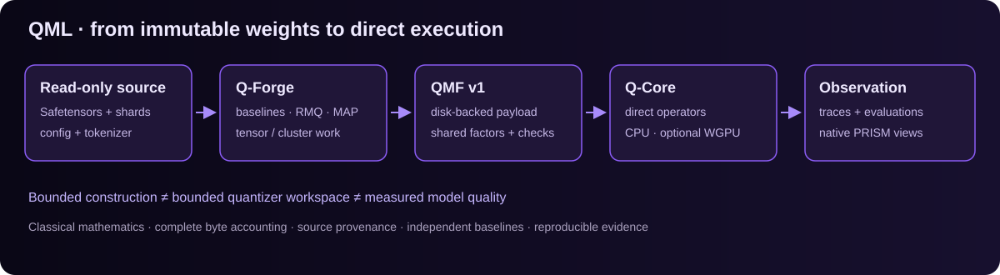
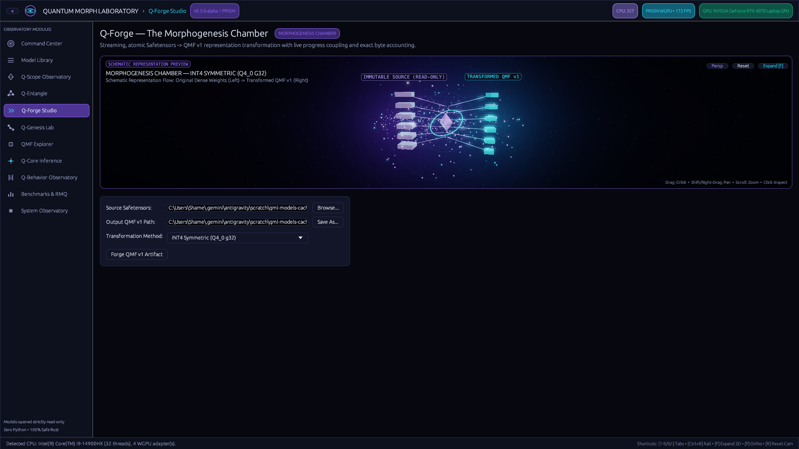
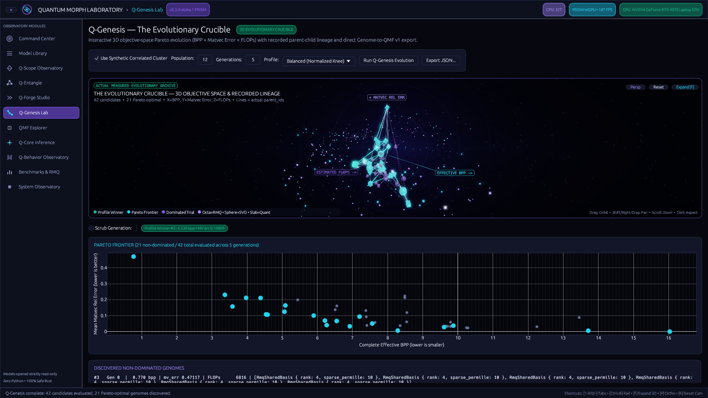

  

  
  
  

<h3 align="center"><em>Don't just compress intelligence. Transform its representation.</em></h3>

Quantum Morph Laboratory is an experimental, local-first scientific laboratory for representing and executing neural networks with less stored information. It combines native model inspection, conventional compression baselines, shared latent representations, direct compressed operators and a working graphical observatory.

**Quantum-inspired means classical mathematics.** QML does not perform physical quantum computation, represent an actual quantum state, or establish quantum advantage. Compression findings remain conditional on their fixtures, models, hardware and evaluation protocols.

## Software distribution

Compiled executables, portable packages, source archives, release notes and SHA-256 checksums are available through the repository's [GitHub Releases section](https://github.com/ShamelesAbyss/Quantum-Morph-Laboratory/releases).

Native Windows and Linux packages contain the real graphical laboratory and CLI. Operating the application does not require Rust, Python, a cloud account or a subscription. Source builds require a Rust toolchain. Software distribution occurs exclusively through native GitHub Releases.

**Latest verified results — SENTINEL v0.6.4:** 19 new synthetic regressions cover Llama/Qwen2 configuration admission and optional attention-bias correctness. All **140 Windows tests and 141 Linux tests** passed, together with formatting, strict Clippy, workspace release builds and dependency policy. The public release and all six assets passed independent verification, including checksums, source identity, packaged documentation/memorial and native CLI smoke tests. See the [supported runtime contract](docs/RUNTIME_ADMISSION.md). Older calibration/reference caches require regeneration into a fresh output directory; historical files are preserved. No new pretrained-model quality or performance result is claimed.

## A scientific instrument, not a compression claim

Our question is whether relationships between tensors can reduce complete representation cost while retaining useful model behavior. QML separates:

- **Implemented mechanisms:** executable Rust readers, operators, quantizers, runtime backends and observatory views.
- **Synthetic evidence:** deterministic matrix, serialization, resource and inference fixtures.
- **Recorded real-model evidence:** model-specific experiments with explicit precision, hardware and evaluation conditions.
- **Research hypotheses:** possible improvements that still require controlled comparisons and reproduction.

The repository preserves unfavorable results and sub-2-bit failure boundaries. A small reconstruction error, agreeable sample or composite score does not establish retained intelligence.

## Architecture — representations through execution

| Layer | Responsibility | Current boundary |
|---|---|---|
| Q-Scope / qml-model | Read-only Safetensors, shard indexes, GGUF inspection, tensor statistics and spectra | Format inspection is distinct from end-to-end architecture support |
| Q-Forge / qml-quant | Conventional baselines, RMQ, MAP, GPTQ, rotations, sparse and low-rank corrections | Quantizers still allocate dense tensor or cluster workspace |
| QMF v1 / qml-format | Typed operators, shared latents, bounded parsing, CRC-32 and artifact SHA-256 | Experimental format; default reader and resource limits remain explicit |
| Q-Core / qml-runtime | Llama-style and Qwen2 decoder inference over compressed operators | SENTINEL validates the [supported configuration subset and optional tensors](docs/RUNTIME_ADMISSION.md); scaled/hybrid or other architectures are rejected |
| Q-Behavior / Q-Genesis | Numerical comparisons, traces, reversible interventions and representation search | Composite numerical fidelity is not a task benchmark |
| PROJECT PRISM / qml-desktop | Native WGPU scientific observatory with real engine integration | Historical screenshots below; no interface redesign is implied |

The 13 Rust crates separate mathematical foundations, format handling, transformation, execution and visualization. See [architecture](ARCHITECTURE.md), [capability reassessment](docs/CAPABILITIES.md) and the [research index](research/prior-art-index.md).

## Mathematical representation concepts

For a layer matrix, independent low-rank approximation uses **W ≈ AB**. RMQ shared-basis experiments use **W_l ≈ U_shared C_l V_sharedᵀ + R_l**; shared-core variants use **W_l ≈ A_l S_shared B_l + R_l**. Residuals, indices and shared structures are part of the representation cost.

MAP selects per-layer representations subject to a byte budget using explicit numerical objectives. Orthogonal Hadamard rotations redistribute coordinates before lossy quantization. Activation-aware blockwise Cholesky GPTQ uses calibration statistics to reduce layer-output error. These are classical numerical methods, with conventional baselines and documented assumptions—not a claim that every combination improves a real model.

Implemented experimental operators include FP16/BF16, groupwise INT8/INT4, packed INT3/INT2/ternary, vector quantization, low-rank factors, shared RMQ factors and ECHO corrections. CPU reference implementations remain the correctness baseline for optional GPU execution.

## QMF and bounded artifact construction

QMF v1 stores a header, deterministic JSON manifest, encoded payload blobs and whole-file CRC trailer. Blob references carry offsets, lengths and CRC-32 checks. Shared latent factors are stored once and reused by compatible operators. Artifact SHA-256 records integrity; it does not authenticate a malicious producer.

PROJECT ATLAS streams encoded payloads to owned temporary disk storage, then streams and verifies a final sibling stage before safe publication. Separate limits govern artifact bytes, builder-owned resident accounting, combined temporary disk, individual tensor allocation and manifest bytes. Explicit overwrite authorization never authorizes replacing a protected source model.

Synthetic eight-tensor fixtures grew payload from **1,048,576 to 33,554,432 bytes**, with **zero resident payload buffer**, a **65,536-byte encoding buffer**, and **151,280–151,728 bytes** of conservative manifest/buffer accounting. These are builder counters, **not process RSS**. Dense tensors, RMQ clusters, quantizer workspace, calibration, reports and OS caches remain additional memory costs.

No 14B, 27B or 32B support was scientifically validated by ATLAS.

## PROJECT PRISM — the native laboratory

<table>
<tr>
<td width="50%">
<strong>Q-Scope:</strong> tensor anatomy and numerical inspection.
</td>
<td width="50%">
<strong>Q-Forge:</strong> representation experiments and compression work.
</td>
</tr>
<tr>
<td width="50%">
<strong>Shared structure:</strong> latent relationships and numerical views.
</td>
<td width="50%">
<strong>Q-Genesis:</strong> evolutionary representation experiments.
</td>
</tr>
</table>

These are committed historical captures of the implemented native application, not mockups or new performance measurements. Render-frame rates are not language-model generation throughput.

## Recorded pretrained-model results

### COLOSSUS — verified source, experiment in progress

Experiment [007](experiments/exp-007-project-colossus.toml) selects only
Qwen2.5-Coder-14B-Instruct. All six original BF16 shards match their official
SHA-256 identities at the pinned revision. Native metadata inspection counts
**14,770,033,664 parameters** and **29,540,133,960 shard-file bytes** (29.54 GB).
The native streamed BF16 reference completed in 1,148.6 seconds with a reported
525.0 MiB layer-weight GPU peak and a separately sampled 3.45 GiB process RAM
peak. These are scoped calibration/reference measurements, not compressed
inference memory or a measured BF16 coding-task baseline.
No compressed-model result is established yet. The fixed protocol separates
14 objective coding/reasoning/explanation/instruction tasks from 1,340 disjoint
calibration tokens and 125 teacher-forced numerical-reference predictions.
See the [research report](docs/PROJECT_COLOSSUS.md) and
[complete inputs and harness](docs/COLOSSUS_REPRODUCTION.md).

Original BF16 task generation is unmeasured after available-RAM preflight;
streaming BF16 numerical references do not substitute for that task baseline.
The published approximately 9 GB Ollama Q4_K_M size is a storage comparator
only, with no measured quality comparison. All model/cache/QMF/result files
remain outside Git under the dedicated D: experiment tree.

### Historical exp-006 — Qwen2.5-7B-Instruct

The following measurements are retained from [exp-006](experiments/exp-006-event-horizon-wave3-7b-sub2bit.toml), recorded for Qwen2.5-7B-Instruct on an i9-14900HX, RTX 4070 Laptop GPU (8 GB), Windows 11 and the specified short evaluation corpus. They were **not rerun during repository restoration**.

| Representation | Complete artifact bpp | Artifact MiB | Reported GPU weight VRAM MiB | Tokens/s | Perplexity ratio vs BF16 | Top-1 agreement |
|---|---:|---:|---:|---:|---:|---:|
| INT4 GPTQ | 4.501 | 4,086.5 | 3,795.1 | 6.8 | 0.98 | 90.9% |
| INT3 Hadamard GPTQ | 3.251 | 2,951.8 | 2,741.5 | 6.8 | 1.07 | 86.3% |
| INT2 Hadamard GPTQ | 2.251 | 2,043.9 | 1,898.7 | 9.7 | 1.43 | 65.7% |
| QMR-200 GPTQ | 2.000 | 1,815.7 | 1,670.4 | 9.1 | 2.13 | 52.6% |
| QMR-175 GPTQ | 1.750 | 1,588.7 | 1,477.6 | 6.9 | 204.53 | 8.0% |
| Ternary Hadamard GPTQ | 1.727 | 1,567.7 | 1,456.5 | 9.5 | 115.92 | 6.3% |

Complete bpp includes serialized container overhead. Reported weight VRAM is not a measurement of total OS/driver memory, KV-cache overhead or process peak. The recorded calibration peak of 444.5 MiB describes layer-streaming VRAM, not whole-process RAM. The two lowest-rate rows show severe degradation; they are preserved as negative results.

Historical token-rate values above remain verbatim. COLOSSUS identified prompt
tokens being included in the generation-rate numerator and a ladder field
mixing evaluation and generation rates. New generation rates count emitted
tokens over total call time including prefill; new evaluation rates are
reported separately. The old rates cannot be corrected without their original
timing records and must not be compared directly with the corrected metric.

The composite numerical fidelity score combines perplexity ratio and top-1 token agreement. It is not retained intelligence, an independent task benchmark or evidence of a power law. Independent reference-runtime comparisons and broader task-level validation remain important research work.

Earlier records remain in [exp-001](experiments/exp-001-rmq-map-qcore-baseline.toml), [exp-002](experiments/exp-002-smollm2-135m.toml), [exp-003](experiments/exp-003-smollm2-360m-gpu.toml), [exp-004](experiments/exp-004-event-horizon-sub3bit.toml) and [exp-005](experiments/exp-005-event-horizon-wave2-gptq-scaling.toml).

## Reproducible source workflow

Use a supported Rust toolchain; see [build instructions](BUILD.md) for dependencies and platform details.

    cargo fmt --all -- --check
    cargo clippy --workspace --all-targets -- -D warnings
    cargo test --workspace
    cargo build --workspace --release
    cargo deny check

    cargo run --release -p qml-desktop
    cargo run --release -p qml-cli -- --help
    cargo run --release -p qml-cli -- scope ./model.safetensors
    cargo run --release -p qml-cli -- morph ./model.safetensors --method int4 --output ./model.qmf
    cargo run --release -p qml-cli -- generate ./model.qmf --config ./config.json --tokenizer ./tokenizer.json --backend cpu --prompt "Explain binary search."

Keep original model files immutable. Use only appropriately licensed checkpoints. Match the model's actual architecture, configuration and tokenizer; unsupported features must not be silently substituted. Record model/config/tokenizer hashes, prompts, seeds, precision, hardware and complete byte accounting when evaluating results.

## Current limits and research direction

- QMF formats and novel representation combinations remain experimental.
- Safetensors ingestion and supported GGUF inspection/codecs do not imply universal GGUF-to-runtime support.
- Dense tensor/cluster quantization and some convenience readers remain memory bottlenecks.
- GPU availability and backend parity depend on actual adapters and supported operations; CPU references remain essential.
- Cache provenance, corruption checks and explicit source protection are required.
- Estimates about consumer-hardware fit are not measured 27B/32B runtime or model-quality results.
- CONTINUUM prioritizes reproducible native reference comparisons and useful model behavior before larger-model or novel-quantizer claims.

See the [roadmap](ROADMAP.md), [novelty ledger](research/novelty-ledger.md), [research synthesis](research/prior-art-synthesis.md), [QMF v1 notes](research/qmf-experimental-v1.md), [handoff](HANDOFF.md), [agent rules](AGENTS.md), [distribution policy](docs/GITHUB_DISTRIBUTION_POLICY.md) and [MIT license](LICENSE).

### In Loving Memory of Ashlan Haley Rapponotti

*June 21, 2003 – November 13, 2026*

For the beautiful woman who listened to my passions, believed in me, and made my world a happier place simply by being part of it.

Every creation, every discovery, and every milestone reached carries a piece of my heart dedicated to you.

**Forever loved. Forever missed. Forever remembered.** 💜
