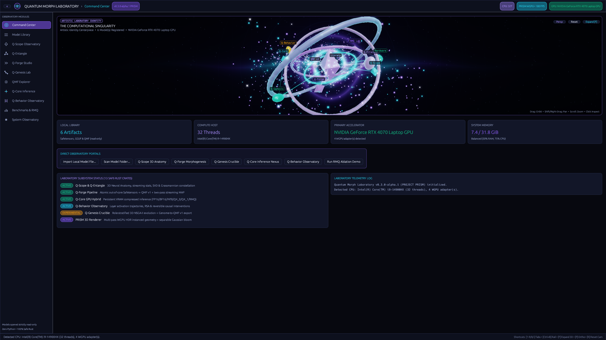
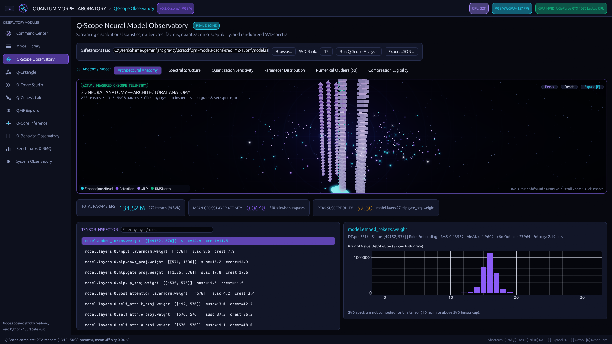
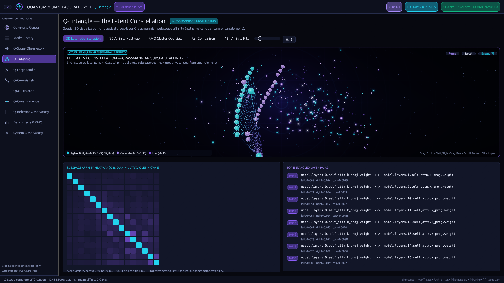
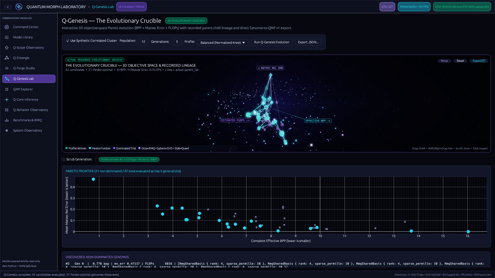
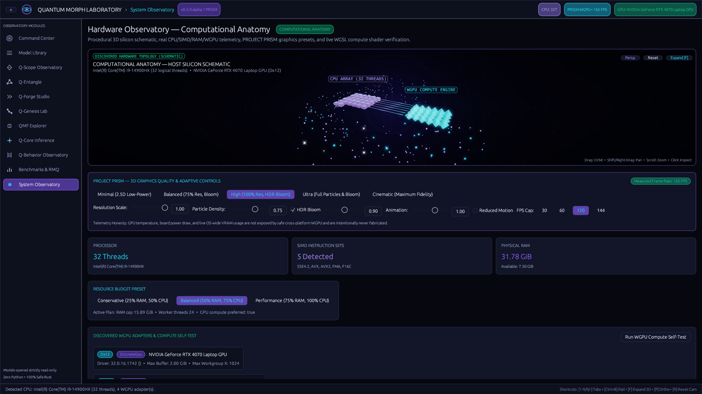

# Quantum Morph Laboratory v0.3.0 | PROJECT PRISM

> *Don't just compress intelligence. Transform its representation.*

**Quantum Morph Laboratory `v0.3.0` (PROJECT PRISM)** is the first full public desktop release of our native, local-first Rust neural model research laboratory. Written in **100% safe Rust (`#![forbid(unsafe_code)]`)** with **zero Python dependencies**, **zero cloud requirements**, and an **MIT License**, `v0.3.0` unites all **13 modular laboratory crates** with a brand-new multi-pass **WGPU 3D scientific observatory** that renders live measured model structure, cross-layer subspace geometry, evolutionary representation discovery, and GPU-accelerated compressed inference directly on your own computer.

> **Experimental Research Software Notice:** Quantum Morph Laboratory is active experimental scientific software—not a production inference server or commercial LLM runtime. Public binary releases make it effortless for researchers and enthusiasts to launch and explore the laboratory without compiling from source, while preserving complete scientific honesty about maturity, experimental formats (`QMF v0/v1`), and known limitations. "Quantum-inspired" refers strictly to classical mathematics (spectral decompositions, tensor networks, Grassmannian subspace geometry) and makes no claim of physical quantum computation.

---

## Direct Downloads (`v0.3.0`)

| Platform | Package | Direct Download |
|---|---|---|
| **Windows 10/11 (x64)** | Standalone Native Desktop App (no installer, no terminal required) | [`Quantum-Morph-Laboratory-v0.3.0-Windows-x64.exe`](https://github.com/ShamelesAbyss/Quantum-Morph-Laboratory/releases/download/v0.3.0/Quantum-Morph-Laboratory-v0.3.0-Windows-x64.exe) |
| **Windows 10/11 (x64)** | Portable Suite (`qml-desktop.exe` + `qml.exe` CLI + Docs + MIT License) | [`Quantum-Morph-Laboratory-v0.3.0-Windows-x64-Portable.zip`](https://github.com/ShamelesAbyss/Quantum-Morph-Laboratory/releases/download/v0.3.0/Quantum-Morph-Laboratory-v0.3.0-Windows-x64-Portable.zip) |
| **Linux (x64)** | Portable Tarball (`qml-desktop` + `qml` CLI + Docs + MIT License) | [`Quantum-Morph-Laboratory-v0.3.0-Linux-x64.tar.gz`](https://github.com/ShamelesAbyss/Quantum-Morph-Laboratory/releases/download/v0.3.0/Quantum-Morph-Laboratory-v0.3.0-Linux-x64.tar.gz) |
| **All Platforms** | Cryptographic Checksums | [`SHA256SUMS.txt`](https://github.com/ShamelesAbyss/Quantum-Morph-Laboratory/releases/download/v0.3.0/SHA256SUMS.txt) |

---

## Live Native WGPU Screenshots (Unedited Captures)

*Captured directly from the compiled Windows `v0.3.0` WGPU release binary running live on an NVIDIA GeForce RTX 4070 Laptop GPU (`157–187 FPS`, `2560×1440` & `1920×1080`).*

<p align="center">
  
  <br/>
  <em><strong>Command Center — The Computational Singularity (2560×1440, 180 FPS):</strong> Interactive 3D orbital observatory core with clickable subsystem portals and real host telemetry.</em>
</p>

<table>
  <tr>
    <td width="50%" align="center">
      
      <br/>
      <em><strong>Q-Scope 3D Neural Anatomy (Real SmolLM2-135M):</strong> 272 measured tensors across 30 transformer layers with 6 live visual modes, 32-bin histogram & SVD spectra.</em>
    </td>
    <td width="50%" align="center">
      
      <br/>
      <em><strong>Q-Entangle Latent Constellation (Real SmolLM2-135M):</strong> 240 measured cross-layer Grassmannian subspace affinity pairs & 2D heatmap.</em>
    </td>
  </tr>
  <tr>
    <td width="50%" align="center">
      
      <br/>
      <em><strong>Q-Genesis Evolutionary Crucible:</strong> 3D objective space (BPP × Matvec Error × FLOPs) with recorded parent-child lineage & Pareto frontier.</em>
    </td>
    <td width="50%" align="center">
      
      <br/>
      <em><strong>Hardware Observatory & PRISM Controls:</strong> 3D CPU/WGPU schematic, 5 graphics presets, live FPS, resource budgets & WGSL compute self-tests.</em>
    </td>
  </tr>
</table>

---

## What's New in PROJECT PRISM (`v0.3.0`)

### 1. New Native WGPU Graphical Architecture & Visual Effects
- **Multi-Pass WGPU Pipeline (`wgpu 24`, DX12 / Vulkan / Metal):** Migrated `qml-desktop` from OpenGL (`glow`) to a custom multi-pass WGPU renderer integrated via `eframe::egui_wgpu::CallbackTrait`, with automatic graceful **2.5D CPU fallback** on headless or low-power systems.
- **7 Original WGSL Shaders (Validated by Automated GPU Tests):**
  - `BACKDROP_WGSL`: Near-black obsidian & deep ultraviolet space with subtle polar/Cartesian interference reticles, Singularity gravitational-lensing accretion horizon, and circular Gaussian pinpoint micro-starfield.
  - `CRYSTAL_WGSL`: Depth-aware (`Depth32Float`) GPU-instanced 3D crystalline meshes (Octahedra, Prism Slabs, UV-Spheres, Torus Rings) with Fresnel iridescence, dual studio lighting, and HDR emission.
  - `FILAMENT_WGSL`: Camera-aligned luminous 3D neural pathway ribbons with traveling spectral energy pulses.
  - `PARTICLE_WGSL`: GPU-driven Keplerian orbital particle halos modulated by live laboratory compute activity.
  - `BLOOM_THRESHOLD_WGSL`, `BLOOM_BLUR_WGSL`, and `COMPOSITE_WGSL`: **`Rgba16Float` HDR** offscreen render target + half-resolution 2-pass separable 9-tap Gaussian selective bloom + ACES filmic tone mapping.
- **5 Persisted Graphics Quality Presets:** `Minimal (2.5D Low-Power)`, `Balanced (75% Res, Bloom)`, `High (100% Res, HDR Bloom)`, `Ultra`, and `Cinematic`, plus resolution scale, particle density, bloom intensity, animation scale, Reduced Motion mode, and FPS caps (`30/60/120/144`).
- **Custom Vector Identity & Ergonomics:** 11 procedural vector subsystem icons, collapsible navigation rail (`Ctrl+B`), breadcrumb header with live measured FPS, global keyboard shortcuts (`1–9/0/-`, `F` fullscreen 3D, `P` ortho/perspective, `R` reset camera, `Esc`), proportional QMF storage treemap, and Q-Core Zen Mode.

### 2. Interactive 3D Scientific Visualization Workspaces
Every 3D viewport supports drag-to-orbit, Shift/right-drag pan, scroll zoom, double-click reset, Perspective/Orthographic switching, 3D ray-sphere picking, and explicit scientific provenance badges distinguishing actual measured data from schematic previews:
- **Command Center — The Computational Singularity:** 3D orbital centerpiece with clickable subsystem portals.
- **Q-Scope — 3D Neural Anatomy:** Layered 3D transformer tower driven by real measured `ModelScopeReport` telemetry across **6 inspection modes** (`Architectural Anatomy`, `Spectral Structure`, `Quantization Sensitivity`, `Parameter Distribution`, `Numerical Outliers (6σ)`, `Compression Eligibility`).
- **Q-Entangle — The Latent Constellation:** 3D spatial helical Grassmannian subspace affinity graph + 2D heatmap + clickable pair detail (explicitly distinguishing classical principal-angle subspace geometry from physical quantum entanglement).
- **Q-Forge — The Morphogenesis Chamber:** Split 3D transformation flow showing read-only source weights morphing across a central manifold into atomic QMF v1 artifacts with live progress coupling.
- **Q-Genesis — The Evolutionary Crucible:** 3D Pareto objective space (`BPP × Matvec Error × FLOPs`) where organism geometry encodes dominant representation family (`Octahedron = RMQ`, `Sphere = SVD`, `Slab = Quant`) and filaments strictly trace actual recorded `parent_ids` lineage.
- **Q-Behavior — Dual Activation Observatory:** Parallel 3D Reference vs Transformed transformer columns bridged by measured cosine similarity, relative L2 drift, and RSA telemetry.
- **System Observatory — Computational Anatomy:** 3D CPU/WGPU silicon topology schematic paired with live WGSL compute self-tests and enforced `ResourcePreset` memory/thread plans.

### 3. Persistent GPU-Resident Compressed Inference & Supported Formats
- **6 Persistent VRAM WGSL Compute Kernels (`qml-hardware` + `qml-runtime`):** `FP32`, `FP16`, `BF16`, `INT8_SYM`, `Q4_0 (INT4_SYM)`, and `Q4_1 (INT4_ASYM)` with `Arc<PersistentGpuMatrix>` deduplication for RMQ Shared-Basis/Core latents and reusable zero-allocation scratch buffers (`QCoreBackend::GpuHybrid`).
- **Supported Model Formats (Strictly Read-Only Source Access):**
  - **Safetensors** (`.safetensors` & sharded `model.safetensors.index.json`): bounded header inspection + constant-memory streaming payload decoding (`F64`, `F32`, `F16`, `BF16`, `F8_E4M3`, `F8_E5M2`, integers, bool).
  - **GGUF v2/v3** (`.gguf`): bounded metadata inspection & tensor payload decoding (`F32`, `F16`, `BF16`, `Q8_0`, `Q4_0`, `Q4_1`).
  - **QMF v0 / v1** (`.qmf`): experimental out-of-core lazy container (`QmfFileReader`), atomic publication (`write_to_file_atomic`) with source-output alias protection, 64 KiB streaming CRC-32 + SHA-256 verification, Shared Latent Table, and sparse COO FP16 residuals.
  - **Hugging Face `config.json` & `tokenizer.json`:** pure-Rust Byte-Level BPE tokenizer with ChatML formatting and stateful UTF-8 `StreamingDecoder`.

### 4. Scientific Research Capabilities & Verified Performance Measurements
- **Q-Scope, RMQ, Two-Pass Streaming MAP, Q-Behavior & Scalable Q-Genesis:** Full local suite for tensor spectral analysis, outlier-peeled RMQ Shared-Basis/Shared-Core (`−49.2%` error via RPCA-inspired peeling on correlated clusters), affinity-gated RMQ, constant-memory MAP allocation, mechanistic activation tracing + RSA + strictly runtime-only reversible causal ablations (`ScaleResidual`, `AblateAttention`, `AblateMlp`), and role/depth-stratified NSGA-II evolution with direct Genome-to-QMF v1 export.
- **Verified Real-Model Performance (`HuggingFaceTB/SmolLM2-360M-Instruct`, RTX 4070 Laptop GPU, `exp-003`):**
  - `INT8_SYM (8.25 bpp, 355.8 MiB VRAM)`: **`20.97 tok/s`** (**`7.49×`** over 32-thread CPU, `95.5%` Top-1 match vs BF16).
  - `INT4_SYM Q4_0 (4.51 bpp, 194.2 MiB VRAM)`: **`18.23 tok/s`** (**`4.87×`** speedup).
  - `MAP Adaptive (4.52 bpp, 194.5 MiB VRAM)`: **`17.54 tok/s`** (**`5.30×`** speedup, `75.0%` Top-1 match vs `70.5%` for uniform `Q4_0`).
- **Verified Desktop PRISM Frame Rates (RTX 4070 Laptop GPU, `High` preset, HDR Bloom enabled):** `180 FPS` at `2560×1440` (Command Center) and `157–187 FPS` at `1920×1080` across all 3D scientific workspaces.
- **Verified Mechanistic Discovery (`SmolLM2-360M` Q-Behavior):** Identified a sharp Layer 31 representational cliff under `Q4_0` (`Rel L2` tripling `0.2038 -> 0.6002`, `RSA` dropping `0.9813 -> 0.5697`) and verified causal criticality of Layer 0 MLP via reversible ablation (`KL = 17.23`, `100%` Top-1 flip).

---

## Installation & Quick Start

### Windows (No Rust, Python, or Terminal Required)
1. **Fastest — Standalone Executable:** Download [`Quantum-Morph-Laboratory-v0.3.0-Windows-x64.exe`](https://github.com/ShamelesAbyss/Quantum-Morph-Laboratory/releases/download/v0.3.0/Quantum-Morph-Laboratory-v0.3.0-Windows-x64.exe) and double-click it to launch the native PRISM desktop laboratory immediately.
2. **Full Portable Suite:** Download [`Quantum-Morph-Laboratory-v0.3.0-Windows-x64-Portable.zip`](https://github.com/ShamelesAbyss/Quantum-Morph-Laboratory/releases/download/v0.3.0/Quantum-Morph-Laboratory-v0.3.0-Windows-x64-Portable.zip), extract it anywhere, and double-click `qml-desktop.exe` (or run `qml.exe --help` for the 14-command CLI).

### Linux (x86_64)
1. Download [`Quantum-Morph-Laboratory-v0.3.0-Linux-x64.tar.gz`](https://github.com/ShamelesAbyss/Quantum-Morph-Laboratory/releases/download/v0.3.0/Quantum-Morph-Laboratory-v0.3.0-Linux-x64.tar.gz).
2. Extract and launch:
   ```sh
   tar -xzf Quantum-Morph-Laboratory-v0.3.0-Linux-x64.tar.gz
   cd Quantum-Morph-Laboratory-v0.3.0-Linux-x64
   ./qml-desktop
   ```

---

## System Requirements

- **Operating System:** Windows 10/11 (64-bit x86_64) or Linux (x86_64 with X11/Wayland).
- **GPU (Recommended):** Any DirectX 12 or Vulkan 1.2+ capable GPU for native WGPU 3D rendering and GPU Hybrid inference. Systems without a compatible GPU automatically fall back to the 2.5D CPU renderer and Rayon multi-threaded CPU inference.
- **Memory:** 8 GB RAM minimum (16–32 GB RAM recommended for 360M–3B parameter model analysis and transformation).
- **External Runtimes:** **None.** Zero Python, zero Node.js, zero CUDA toolkit installation required.

---

## SHA-256 Checksum Verification

Verify your download against [`SHA256SUMS.txt`](https://github.com/ShamelesAbyss/Quantum-Morph-Laboratory/releases/download/v0.3.0/SHA256SUMS.txt):

- **Windows (PowerShell):**
  ```powershell
  Get-FileHash .\Quantum-Morph-Laboratory-v0.3.0-Windows-x64.exe -Algorithm SHA256
  ```
- **Linux:**
  ```sh
  sha256sum -c SHA256SUMS.txt --ignore-missing
  ```

---

## Known Limitations

- **Experimental Container Format:** `QMF v0/v1` are active research container formats and may evolve across future minor versions.
- **Hybrid GPU Execution Scope:** `QCoreBackend::GpuHybrid` keeps persistent compressed linear projections in VRAM while running lightweight RMSNorm, RoPE, and KV-cache attention on CPU; full GPU-resident attention & KV-cache kernels are planned for a future release.
- **Model Architecture Scope:** `QCoreModel` currently targets Llama/SmolLM-style decoder-only transformers; additional architectures (Qwen2 attention biases, Mistral, MoE) are planned.
- **Telemetry Honesty:** Safe cross-platform WGPU intentionally does not expose GPU die temperature, board power draw, or OS-wide VRAM usage; the laboratory never fabricates these values.
- **Windows SmartScreen:** Because this is an open-source MIT binary without a paid commercial code-signing certificate, Windows SmartScreen may display an "Unknown publisher" prompt on first launch; verify the SHA-256 checksum against `SHA256SUMS.txt` before running.

---

## Quality & Security Verification

- **License:** MIT ([LICENSE](https://github.com/ShamelesAbyss/Quantum-Morph-Laboratory/blob/main/LICENSE))
- **Rust CI (Windows & Ubuntu):** `cargo fmt --all -- --check`, `cargo clippy --workspace --all-targets -- -D warnings`, and all **81 automated tests** across **13 safe-Rust crates** pass cleanly.
- **Dependency Policy (`cargo-deny 0.21.0`):** `advisories ok, bans ok, licenses ok, sources ok` — zero ignored advisories.

---

### In Loving Memory of Ashlan Haley Rapponotti

*June 21, 2003 – November 13, 2026*

For the beautiful woman who listened to my passions, believed in me, and made my world a happier place simply by being part of it.

Every creation, every discovery, and every milestone reached carries a piece of my heart dedicated to you.

**Forever loved. Forever missed. Forever remembered.** 💜
